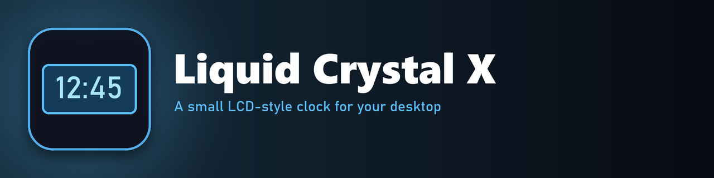

  
  
  

**Liquid Crystal X** is a small clock that looks like an old LCD display.

## What it does

- **Shows the time** in a digital LCD font on a blue panel.
- **Portable.** It uses relative paths and loads its font from its own folder, so you can copy it to any PC without installing the font in Windows.

## Font

The clock uses the **Digital-7 Mono** font by Style-7, free for personal use from [styleseven.com](https://www.styleseven.com). Its license doesn't allow sharing it, so download it and put it in `@Resources/Fonts` as `digital-7 (mono).ttf`. Rainmeter loads it from there by itself.

## Install

Download the `.rmskin` file from **[Releases](https://github.com/SteelArchadian/Liquid-Crystal-X/releases/latest)** and double-click it. Rainmeter installs and loads it.

## Credits and license

Liquid Crystal X is a rework of **Liquid Crystal** by **[kop4](https://www.deviantart.com/kop4)**, whose license says "Do whatever you want". Thank you, kop4!

What's different from the original: relative paths and a font loaded from the skin's own folder.

Made with AI assistance.

## Bugs and ideas

Post them on [GitHub Issues](https://github.com/SteelArchadian/Liquid-Crystal-X/issues).
